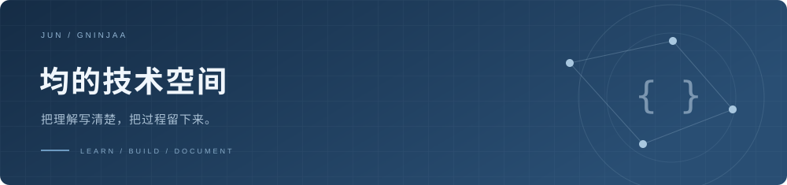

  

<table>
<tr>
<td width="58%" valign="top">

### 你好，我是均 👋

正在学习 **Python 与 AI Agent 应用开发**。

喜欢从具体的问题出发，读一段源码，做一个小实验，再把理解写下来。

- 🔎 关注工具调用、上下文管理与多 Agent 协作
- 🛠️ 在项目学习与实践中积累开发经验
- 📝 把理解写清楚，把过程留下来

[**阅读我的技术博客 ↗**](https://jun-tech-notes.neatterrapin.chatgpt.site)

</td>
<td width="42%" align="center" valign="middle">
  
   
  慢慢学，认真做。 · <a href="https://tenor.com/view/lofi-browsing-studying-anime-gif-17529094">GIF 来源：Tenor</a>
</td>
</tr>
</table>

### 🧩 项目与实践

| 项目 | 内容 | 入口 |
| :--- | :--- | :--- |
| **AfterFlow** | 电商智能客服 Agent，围绕业务场景学习 Agent 应用开发。 | [查看仓库 ↗](https://github.com/Gninjaa/afterflow-agent) |
| **RepoScope** | 面向 GitHub Issue、PR 与 CI 的多 Agent 研发协作工作台，关注协作流程与上下文管理。 | [查看仓库 ↗](https://github.com/Gninjaa/reposcope) |

这里展示项目学习与实践记录；具体实现、验证范围及课程或 AI 辅助情况，以各仓库说明和相关记录为准。

### 🌱 正在探索

`Python` · `AI Agent` · `工具调用` · `上下文管理` · `多 Agent 协作`

从「能运行」走向「能解释」，也继续练习独立实现与验证。

### 🤝 开源协作

**Tenuo / LangGraph** — 参与补充基于 `Send` 的并行 worker 权限示例及测试，相关 [PR #1033](https://github.com/tenuo-ai/tenuo/pull/1033) 已合并。

AI 辅助协作：由我确认方案与修改，AI 协助实现、测试和提交。

### 📖 最近的技术笔记

[读 RepoScope 源码：工具结果太长，Agent 怎么处理？](https://jun-tech-notes.neatterrapin.chatgpt.site/posts/reposcope-tool-context/)

从一段上下文处理代码出发，区分完整工具记录与模型本轮输入，并记录截断可能带来的信息损失。

---

  保持好奇，持续求证。 LEARN SOMETHING. BUILD SOMETHING. WRITE IT DOWN.

